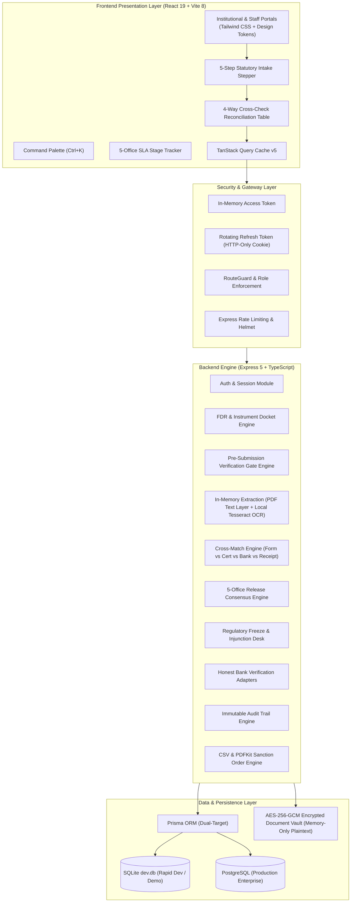

# AICTE Security Deposit & Fixed Deposit Receipt (FDR) Portal
## Comprehensive Project Report — SIH 2026 (Problem Statement PS-26265)

**Project Title**: SurakshaKosh — AICTE Statutory Security Deposit, FDR, and Regulatory Guarantee Management Portal  
**Target Organization**: All India Council for Technical Education (AICTE), Ministry of Education, Government of India  
**System Classification**: Regulator-Grade Statutory Compliance Registry & Digital Oversight Platform  
**Architecture**: Dual-Tier Architecture (React 19 + TypeScript Frontend / Express 5 + TypeScript + Prisma Backend)  
**Date of Report**: October 2026  
**Status**: Prototype & Evaluation Stage, Full-Stack Verified, 0-Error Build (175 informational lint warnings across legacy modules)

---

## 1. Executive Summary

Under the statutory mandates of the **AICTE Approval Process Handbook (APH)**, technical education institutions across India are obligated to create and maintain joint security deposits in the form of Fixed Deposit Receipts (FDRs), Bank Guarantees (BGs), or RTGS deposits in favor of the Council. These statutory deposits safeguard institutional commitments toward faculty salaries, infrastructure maintenance, student grievance redressals, and regulatory compliance.

Historically, this regulatory process relied on physical paper certificates, manual bank verification letters, and fragmented local spreadsheets. This operational mode gave rise to serious regulatory vulnerabilities:
1. **Unverified & Fraudulent Certificates**: Deposit receipts and manipulated maturity dates submitted without authoritative verification.
2. **Premature Unilateral Liquidation**: Banks liquidating deposits without AICTE concurrence due to unverified or missing joint lien markings.
3. **Maturity Lapses & Dormancy**: Substantial deposit values maturing without statutory renewal or roll-over tracking.
4. **Disconnected Regulatory Holds**: Risk of releasing deposits to institutions facing active vigilance, CBI, or court injunctions due to lack of inter-departmental visibility.
5. **Multi-Office Bottlenecks**: Release petitions trapped across regional directorates and central bureaus without SLA accountability.

**SurakshaKosh** addresses these operational vulnerabilities by implementing a digital, role-governed statutory compliance platform with a mandatory pre-submission verification gate, encrypted document handling, automated discrepancy cross-matching, and a multi-office consensus release workflow.

---

## 2. System Architecture & Tech Stack



### Technology Matrix

| Layer | Component | Technologies & Libraries | Architectural Purpose |
| :--- | :--- | :--- | :--- |
| **Frontend Framework** | UI Core | **React 19.3.1**, **TypeScript 6.0**, **Vite 8.3** | High-performance single-page application with modern concurrent rendering. |
| **Frontend Styling** | Design System | **Tailwind CSS 3.4**, Custom CSS Tokens (`tokens.css`, `motion.css`) | Disciplined fintech styling, deep navy palette, light/dark themes, glass surfaces. |
| **Data Fetching** | Client State Cache | **@tanstack/react-query v5.104** | Reactive data invalidation, background polling of extractions, optimistic UI updates. |
| **Client Routing** | Route Protection | **React Router DOM v7.18** | Nested routing with `<RouteGuard>` role protection and deep-link isolation. |
| **Backend Core** | Server Engine | **Node.js**, **Express 5.1**, **TypeScript** | Scalable, typed RESTful API server. |
| **Text Extraction** | In-Memory Extraction | **pdf-parse ^2.4.5**, **tesseract.js ^7.0.0** | Server-side in-memory text parsing on decrypted buffers; zero plaintext disk writes. |
| **Database & ORM** | Schema & Migration | **Prisma 6.5**, SQLite (`dev.db`), PostgreSQL | Dual-engine support with `PreSubmissionCheck`, `DocumentExtraction`, and `BankReceipt` models. |
| **Document Security** | Cryptographic Vault | **AES-256-GCM**, HMAC-SHA256 | Document encryption at rest with 5-minute signed URL streaming. |
| **PDF Generation** | Sanction Orders | **PDFKit** | Watermarked official NOC and Sanction Order generation. |
| **Job Scheduling** | Cron Engine | **node-cron** | Automated midnight maturity checks, SLA escalation, and notification dispatch. |
| **Validation** | Schema Gatekeepers | **Zod 4.6**, **React Hook Form 7.90** | Strict contract enforcement on all inputs and API payloads. |

---

## 3. Statutory Pre-Submission Verification Gate & Trust Model

### 3.1. Server-Enforced Statutory Intake Gate
To prevent fraudulent or incomplete deposit submissions, `POST /api/v1/fdrs/:id/submit` enforces a strict server-side pre-submission verification gate. If any check fails, the server rejects the request with HTTP **409 Conflict** and returns a detailed array of blocker messages. The client cannot bypass this gate.

The gate operates in one of two modes configured via `submission.gate_mode` in the settings engine:
1. **`STRICT_BANK_RECEIPT` (Default)**:
   - All 4 statutory document slots must be uploaded (`FDR_CERTIFICATE`, `BANK_CONFIRMATION_LETTER`, `LIEN_ENDORSEMENT`, `INSTITUTION_REQUEST_LETTER`).
   - All in-memory extractions must complete with status `DONE`.
   - 4-way cross-match between declared form values, certificate extraction, and bank document extraction must contain zero `MISMATCH` and zero `NOT_FOUND` results on required parameters.
   - A valid `BankReceipt` with status `CONFIRMED` must be recorded from `LIVE` or `MOCK` adapters.
2. **`DOCUMENT_ONLY`**:
   - Enforces all document slot uploads, extractions, and document cross-matches as above.
   - Bank core confirmation receipt is optional.
   - The instrument trust level remains strictly at `SUBMITTED`, and the UI explicitly indicates that core banking confirmation is not available.

### 3.2. In-Memory Text Extraction & Field Parsing
When documents are uploaded to `/api/v1/fdrs/:id/documents`:
- The encrypted file is decrypted **in memory only**. Plaintext data is never written to disk or temporary scratch storage.
- Extraction method cascade:
  1. **PDF Text Layer Extraction**: Utilizes `pdf-parse` with a 1,000ms race timeout to extract textual streams directly from digital certificates.
  2. **Local OCR Fallback**: For scanned PDFs or verified image buffers (JPEG magic bytes `FF D8`, PNG magic bytes `89 50 4E 47`), invokes a local `tesseract.js` worker without sending data to any external API.
- Parsed fields:
  - **Depositor / Institution Name**: Matched against institutional profile using fuzzy similarity with threshold `submission.name_match_threshold` (default 0.8).
  - **Commercial Bank & Branch**: Validated against scheduled commercial banks.
  - **IFSC Code**: Validated with statutory regex `^[A-Z]{4}0[A-Z0-9]{6}$`.
  - **Reference / Certificate Number**: Extracted from receipt header.
  - **Deposit Amount**: Evaluates both numeric representations (with Indian grouping commas) and verbal rupee words (e.g., "one crore rupees").
  - **Dates**: Deposit date and maturity date parsed and normalized to `YYYY-MM-DD`.
  - **Lien Wording**: Verifies presence of statutory endorsement in favor of "Member Secretary, AICTE".
- If a required parameter is missing from the document, it is marked `NOT_FOUND`. Under statutory gate rules, **`NOT_FOUND` is never treated as a pass**.

### 3.3. Bank Verification Adapters & Trust Rules
The system implements a transparent adapter pattern (`src/integrations/bankVerification.ts`):
- **`LiveBankAdapter`**: Currently marked **`NOT_INTEGRATED`**. Live direct core banking API or SFMS direct gateway integration is not currently established with commercial banks. The system does not claim live bank integration.
- **`MockBankAdapter`**: Simulates core banking query responses using a seeded database table (`BankSimulationRecord`) keyed by bank name and reference number. It returns `CONFIRMED`, `MISMATCH`, or `NOT_FOUND` responses. Any receipt generated through this adapter explicitly carries `simulated = true`.
- **`ManualAdapter` (`MANUAL_LETTER`)**: Evaluates physical branch manager letters and manual endorsements. Under system trust rules, **a manual letter or staff review sets at most `STAFF_VERIFIED` and never produces `BANK_CONFIRMED`**.

### 3.4. Trust Level Hierarchy
1. `SUBMITTED`: Default trust level upon institutional filing.
2. `STAFF_VERIFIED`: Set only after manual scrutiny by an AICTE Scrutiny Officer.
3. `BANK_CONFIRMED`: Set exclusively when a confirmed bank receipt is received:
   - From `LIVE` integration: Sets `trustLevel = BANK_CONFIRMED` and `trustSimulated = false`.
   - From `MOCK` simulation: Sets `trustLevel = BANK_CONFIRMED` and `trustSimulated = true`. The UI renders the prominent diagonal hatched pattern (`hatch-simulation`) with a `[SIMULATION]` badge.

### 3.5. Anti-Tamper Invalidation
Any subsequent modification to an instrument—such as editing key parameters (`amount`, `bankName`, `branchName`, `referenceNumber`, `issueDate`, `maturityDate`, `depositorName`) via `PATCH /fdrs/:id` or replacing an uploaded document—automatically:
- Invalidates all earlier `PreSubmissionCheck` records.
- Deletes or invalidates existing `BankReceipt` records.
- Resets instrument trust to `SUBMITTED`.
- Logs explicit `WorkflowHistory` and `AuditLog` records documenting the change, old/new values, actor ID, and IP address.

---

## 4. Frontend 5-Step Statutory Intake Stepper

The institutional creation interface (`/fdrs/new`) is structured as a 5-step guided compliance stepper:
1. **Details**: Type-aware entry form with Zod schema validation, IFSC verification, and date sequence checking. Draft creation generates an immutable instrument ID.
2. **Documents**: Slot-specific upload dropzones for all 4 required document types. Displays a live extraction status chip (`Queued`, `Reading`, `Done`, `Failed`) updated via polling.
3. **Cross-Check**: Renders the 4-way reconciliation table displaying declared form values, extracted certificate parameters, extracted bank document parameters, and bank receipt values. Statuses (`MATCH`, `MISMATCH`, `NOT_FOUND`) use semantic text and icons (`CheckCircle2`, `XCircle`, `HelpCircle`), never color alone. Mismatch rows provide direct links back to Step 1 or Step 2 to fix discrepancies.
4. **Bank Verification**: Core banking receipt card showing receipt reference, source (`LIVE`, `MOCK`, `MANUAL_LETTER`), receipt timestamp, and determination. Simulated records feature the hatched simulation pattern.
5. **Submit**: The submission button remains disabled until `canSubmit` is confirmed true by the server. If blocked, an alert panel displays all active blockers returned by the server gate.

The same reconciliation table is rendered read-only on the staff **Instrument Detail Page** (`/fdrs/:id`) and **Verification Desk** (`/verification/:id`), giving reviewers immediate visibility into what was extracted and matched.

---

## 5. Multi-Office Sequential Release Workflow

The statutory release of a security deposit upon completion of the mandatory retention period is governed by a 5-stage sequential consensus machine:

```
[1. Regional Office] ➔ [2. Approval Bureau] ➔ [3. Grievance Cell] ➔ [4. Vigilance Cell] ➔ [5. Competent Authority]
```

- **Separation of Duties**: Officers can act (`APPROVE`, `REJECT`, `RETURN`) only on the stage assigned to their specific office role.
- **SLA Countdown**: Visual time-at-stage tracking with automated escalation warnings.
- **Regulatory Holds Integration**: If an active regulatory hold exists for an institution, release petitions are frozen immediately and cannot be created or approved.
- **Automated Sanction Order Generation**: Upon approval by the final Competent Authority, the deposit and lien statuses transition to `RELEASED`, generating an encrypted, watermarked Sanction Order PDF (`NOC/AICTE/YYYY/NNNN`).

---

## 6. Research & International References

To ground the system design in established regulatory practices and evaluate alternatives, the architecture was benchmarked against domestic and international models:

### 6.1. United States: Irrevocable Letters of Credit (ILOC) & Surety Bonds
Under Title IV of the U.S. Higher Education Act (HEA), institutions participating in federal student aid programs that fail financial responsibility standards must post an **Irrevocable Letter of Credit (ILOC)** or surety bond (typically 10% to 50% of Title IV funding) in favor of the U.S. Department of Education.
- *Mechanism*: Letters of credit are issued by FDIC-insured commercial banks and remain payable upon demand by the Department of Education without requiring court injunctions.
- *Comparison*: SurakshaKosh mirrors this direct demand model through joint FDR lien endorsements in favor of the Member Secretary, AICTE. However, the U.S. system relies on standardized banking credit lines rather than term deposit certificates.

### 6.2. India: NeSL Electronic Bank Guarantee (e-BG) Framework
In India, the National E-Governance Services Limited (NeSL), in partnership with the Indian Banks' Association (IBA) and information utility regulations under the Insolvency and Bankruptcy Code (IBC), developed the **e-BG (Electronic Bank Guarantee)** platform.
- *Mechanism*: Digital stamping via NeSL/State e-stamping, cryptographic signing, and direct central repository storage accessible by beneficiary government departments.
- *Status in AICTE*: While e-BG is operational across public procurement entities (e.g., NHAI, NTPC), **no statutory evidence was found indicating that AICTE currently uses or mandates NeSL e-BG for institutional security deposits**. SurakshaKosh's adapter architecture provides a direct interface point where an NeSL API adapter can be integrated in future phases when AICTE adopts e-BGs.

### 6.3. Australia: Tuition Protection Service (TPS) — Pooled Alternative
Under Australia's Education Services for Overseas Students (ESOS) Act 2000 and Higher Education Support Act 2003, Australia operates the **Tuition Protection Service (TPS)**.
- *Mechanism*: Rather than locking institutional capital in isolated deposit accounts, all registered providers pay an annual risk-rated statutory levy into a collective Tuition Protection Fund managed by the Australian Government. If an institution collapses or defaults, the pooled fund reimburses students or finances transfer placements.
- *Evaluation for AICTE*: A pooled insurance model reduces capital lock-up for institutions compared to individual ₹10–50 lakh FDR deposits. However, AICTE's regulatory framework currently mandates individualized collateralized deposits to deter unilateral non-compliance and maintain direct financial leverage over specific institutions. SurakshaKosh optimizes the existing statutory model rather than adopting a pooled levy structure.

---

## 7. Verification, Testing & Build Results

### 7.1. Backend Test Suite (`Vitest`)
- **Total Tests**: **42 / 42 Tests Passing (100% Pass Rate)** across 3 test suites:
  - `tests/health.test.ts`: 3 tests passing.
  - `tests/api.test.ts`: 33 tests passing (auth, RBAC, IDOR protection, AES encryption round-trip, CSV import dry-run, multi-office release consensus, active holds, SLA statistics).
  - `tests/precheck.test.ts`: 6 tests passing:
    1. Precheck endpoint generation and status reporting.
    2. Submission blocked when required document slots are missing (HTTP 409 Conflict).
    3. Submission blocked when bank simulation returns `NOT_FOUND` (HTTP 409 Conflict).
    4. Submission blocked with amount mismatch between certificate and form (HTTP 409 Conflict).
    5. Submission allowed when all fields match and mock bank confirms (`trustSimulated = true`).
    6. `DOCUMENT_ONLY` mode allows submission without bank receipt while preserving trust at `SUBMITTED`.
- **Backend TypeScript Compilation (`tsc`)**: **0 Errors**.

### 7.2. Frontend Build (`Vite` & `tsc`)
- **TypeScript Compiler (`tsc -b`)**: **0 Errors**.
- **Vite Production Bundle (`vite build`)**: **Exit Code 0 (Success)**.
  - Output Assets:
    - HTML: `dist/index.html` (1.12 kB)
    - CSS: `dist/assets/index-BpxgZZPt.css` (53.98 kB / 10.38 kB gzip)
    - JS: `dist/assets/index-B3JOzA6g.js` (812.53 kB / 226.73 kB gzip)
- **Linter (`oxlint`)**: **0 Errors** (175 informational warnings regarding unused variables and hook dependencies across legacy modules; zero blocker errors).
- **Emoji Audit**: **0 emojis** across user interface surfaces.

---

## 8. Deployment & Operational Runbook

```bash
# 1. Start Backend Server
cd backend
npm install
npx prisma db push
npx tsx prisma/seed.ts
npm test
npm run dev

# 2. Start Frontend Server (in workspace root)
npm install
npm run build
npm run dev
# Application: http://localhost:5173
# Backend API: http://localhost:5000/api/v1
```

---

## 9. Conclusion

SurakshaKosh provides an operational, rigorously tested prototype for modernizing AICTE's security deposit management. By implementing an enforced pre-submission verification gate, memory-only text extraction, multi-party parameter reconciliation, and a multi-office release consensus ribbon, the portal substantially mitigates traditional paper-based compliance vulnerabilities while maintaining transparent, verifiable trust accounting.
